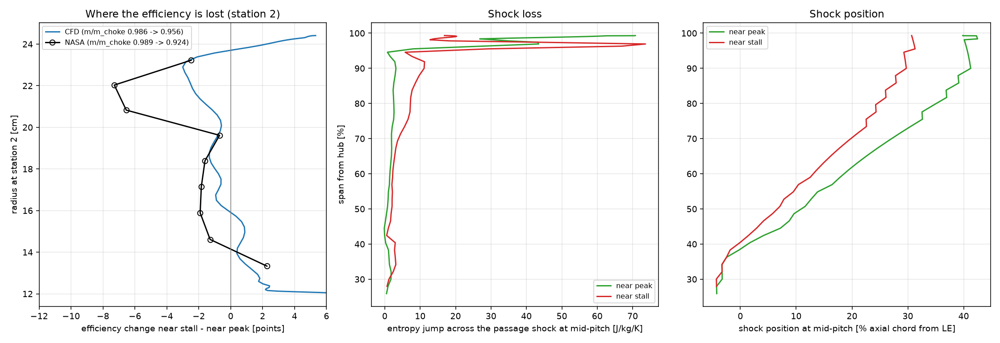
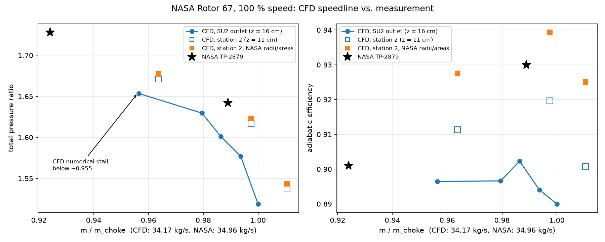
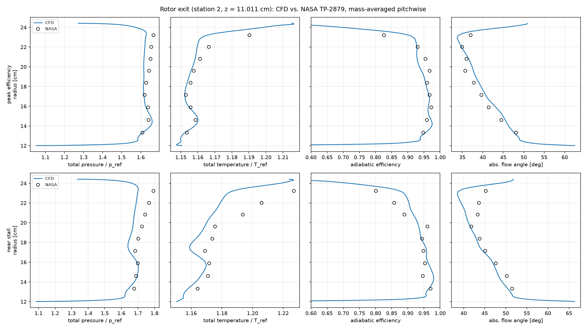
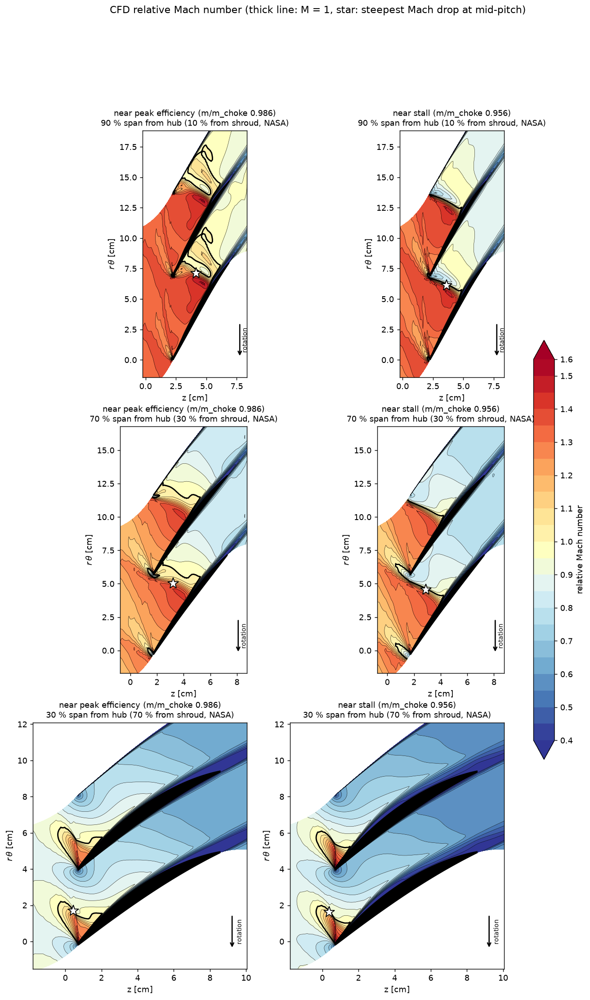
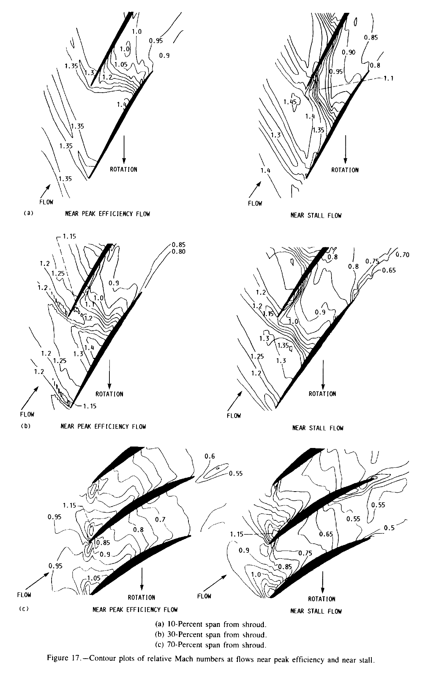
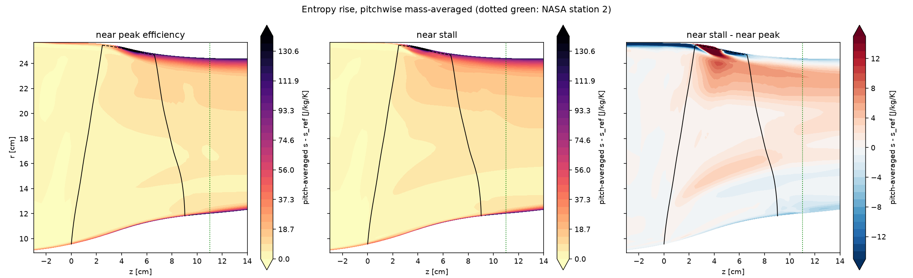
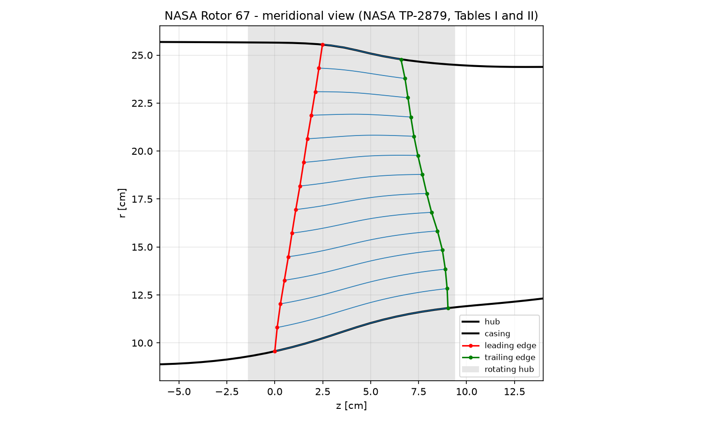
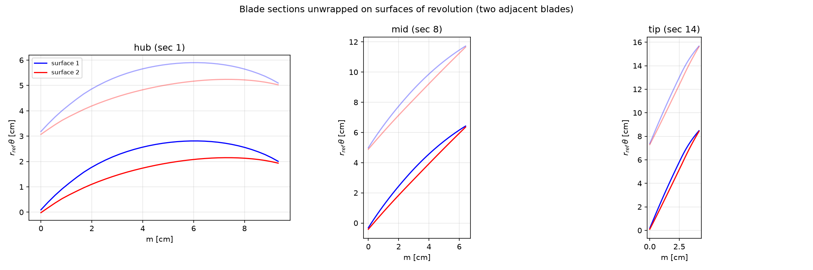

# NASA Rotor 67 — 3D RANS CFD: why efficiency drops near stall

Single-passage 3D RANS analysis of **NASA Rotor 67**, the low-aspect-ratio transonic fan rotor of
NASA TP-2879 (Strazisar et al., 1989), with an open-source toolchain: a structured H-grid written from
scratch in Python and the **SU2** compressible solver.

This is the follow-up to [transonic-fan](https://github.com/SirPicklee/transonic-fan), where a meanline /
radial-equilibrium model of the same rotor predicted the near-stall pressure ratio within 0.3 % but **not**
the efficiency drop from 0.930 (peak efficiency) to 0.901 (near stall). The NASA laser data show the passage
shock moving upstream as the rotor approaches stall — a shock-position effect a one-dimensional model cannot
represent. This project resolves that effect in 3D.

## Key findings

1. **The CFD reproduces the measured rotor.** Averaged the way NASA averaged its survey data, the peak-efficiency
   solution is within **1.2 % in pressure ratio and +0.9 points in efficiency** of the measurement, and the
   spanwise total pressure, total temperature and flow-angle profiles at the rotor exit follow the survey data.
2. **The extra loss near stall is generated by the shock in the outer 35 % of the span.** Between the two
   operating points the passage shock at 90 % span moves forward from 41 % to 30 % of the axial chord and
   steepens by ~13°, while the relative Mach number ahead of it stays at **1.46**. The entropy jump across the
   shock grows **3.5 times** (3.2 → 11.1 J/kg/K). The loss increase is concentrated at 65–95 % span in both the
   CFD and the NASA survey, and both show a small efficiency *gain* at the hub.
3. **Why the meanline model missed it.** Shock-loss correlations such as Miller–Lewis–Hartmann take the inlet
   relative Mach number and an assumed shock position. The inlet Mach number does not change between the two
   points; the shock *angle and position* do. Only a model that resolves the shock location can see this loss.
4. **Limitation.** The CFD stalls numerically at m/m_choke ≈ 0.955, before the measured near-stall point
   (0.924), so it captures the mechanism and the location of the loss but roughly half of its magnitude.

<p align="center"></p>

---

## Operating points

Mass flows are compared as a fraction of each data set's own choke flow (CFD 34.17 kg/s, NASA 34.96 kg/s,
a 2.3 % difference typical of RANS predictions of this rotor).

| | outlet (mid-span static) | m/m_choke | PR | η (SU2 outlet) | η (station 2, NASA radii) |
|---|---|---|---|---|---|
| CFD choke | 115 kPa | 1.000 | 1.519 | 0.890 | 0.925 |
| CFD | 121 kPa | 0.994 | 1.577 | 0.894 | |
| **CFD near peak efficiency** | 123 kPa | **0.986** | **1.601** | 0.902 | **0.939** |
| CFD | 126 kPa | 0.980 | 1.630 | 0.897 | |
| **CFD near stall** (last stable point) | 128.5 kPa | **0.956** | **1.653** | 0.897 | **0.928** |
| NASA near peak efficiency | | 0.989 | 1.642 | | 0.930 |
| NASA near stall | | 0.924 | 1.728 | | 0.901 |

* **Efficiency definitions matter.** SU2 reports the mixed-out efficiency at the domain outlet, 5 cm
  downstream of NASA's station 2, including the duct and the endwall layers. NASA averaged nine radial
  survey points with area elements that exclude ~1.5 % (hub) and ~1.3 % (tip) blockage (TP-2879 table IV).
  Sampling the CFD the same way (`scripts/05_compare_nasa.py`) moves the peak efficiency from 0.902 to 0.939.
* At 131 and 133 kPa the mass flow drifts down continuously and the pressure ratio passes through a maximum —
  the numerical stall of the steady computation.

<p align="center"></p>
<p align="center"></p>

## Shock structure

Relative Mach number on surfaces of constant span, oriented like NASA's figure 17 (flow from the lower left,
rotor moving down). Thick line: M = 1; star: steepest Mach drop on the mid-pitch line.

| CFD (this work) | NASA TP-2879 figure 17 (laser anemometry) |
|---|---|
|  |  |

NASA's spans are measured from the shroud: 10 / 30 / 70 % from the shroud = 90 / 70 / 30 % from the hub.

Shock on the mid-pitch line (`scripts/07_loss.py`):

| span from hub | position, peak → stall [% axial chord] | Mach before → after, peak | Mach before → after, stall | entropy jump peak → stall [J/kg/K] |
|---|---|---|---|---|
| 50 % | 11.6 → 7.1 | 1.28 → 0.97 | 1.30 → 0.91 | 0.8 → 2.1 |
| 70 % | 26.4 → 19.3 | 1.39 → 0.97 | 1.37 → 0.87 | 1.9 → 3.6 |
| 80 % | 34.7 → 24.2 | 1.43 → 0.96 | 1.42 → 0.84 | 2.6 → 7.2 |
| 90 % | 41.3 → 29.7 | 1.46 → 0.95 | 1.46 → 0.83 | 3.2 → 11.1 |

Converting the entropy jumps at 90 % span to an equivalent normal-shock Mach number gives ~1.24 near peak
efficiency and ~1.38 near stall for the same upstream Mach number of 1.46: the shock turns from ~58° to ~71°
and its loss rises from ~20 % to ~65 % of a normal shock's. In both CFD and measurement the near-stall shock
sits at the passage entrance; in the measurement, at the lower near-stall flow, it has detached ahead of the
leading edge.

<p align="center"></p>

The difference map (right) shows where the extra entropy is created: at the tip, between 25 and 60 % chord,
where the forward-moved shock meets the tip-clearance flow. It then convects to 65–95 % span at station 2.

---

## Method

### Geometry

Blade and flowpath transcribed from NASA TP-2879 tables I and II (scanned tables → two OCR passes →
smoothness and physics checks → visual check of every flagged cell):

| File | Content |
|---|---|
| `data/rotor67_blade_sections.csv` | 14 sections × 35 points: z, r, θ of both surfaces, thickness, camber angles |
| `data/rotor67_flowpath.csv` | hub and casing contours |
| `data/rotor67_blade_edges.csv` | leading/trailing edge circles |

Independent checks: section 1 lies on the hub within 0.012 mm and section 14 on the casing within 0.045 mm;
computed solidity (1.29 tip, 3.11 hub) and maximum thickness match the published design values. The running
tip is the casing offset by the 1.016 mm clearance.

<p align="center"> </p>

### Mesh

Structured single-passage **H-grid**, generated in Python (`scripts/02-04`) and written directly in SU2 format.

| | |
|---|---|
| Cells | 1.38 M hexahedra (156 streamwise × 96 pitchwise × 101 spanwise, blade interior removed) |
| Tip gap | 16 cells across the clearance; the blade strip is meshed above the tip for the leakage flow |
| Walls | 15 µm first cell on the blade, 20 µm on hub, tip and casing; 33 µm streamwise at LE and TE |
| Quality | no negative volumes, pitchwise growth ≤ 1.2 in the passage, grid-line turning ≤ 15°, periodic faces match to 1e-16 m |
| Limitation | flat leading/trailing edge faces instead of the 0.2–0.5 mm edge circles; blade-surface y+ ≈ 7 (median) |

### Solver (SU2 8.5, mixed-precision build)

| | |
|---|---|
| Model | steady RANS, Spalart–Allmaras, resolved to the wall (no wall functions) |
| Frame | rotating frame, 16 043 rpm (1680 rad/s) |
| Inlet | Giles, total conditions 101 325 Pa / 288.15 K, axial |
| Outlet | Giles, radial equilibrium, static pressure prescribed at mid-span |
| Walls | blade and rotating hub turn with the rotor; casing and stationary hub via `MARKER_SHROUD` |
| Numerics | Roe first order for the start-up, then JST second order; implicit, ILU, adaptive CFL |
| Start-up | rotation ramped 0 → 1680 rad/s over 2000 iterations together with the outlet pressure (`RAMP_OUTLET`) |

### What it took to make it converge

The robustness problems were all traced with residual maps of the last solution before divergence
(`scripts/diag_residual.py`, `scripts/mesh_kinks.py`):

* **Wall functions** diverged at CFL ≈ 7 → removed (the mesh resolves the wall to y+ ≈ 7).
* **Second-order schemes** (Roe-MUSCL and JST) diverged at the blunt trailing edge, where the base pressure
  collapsed: the TE face (0.4 mm) had only one streamwise cell, and blending the pitchwise distribution
  towards uniform created 155° grid-line kinks at the edges. Fixed with 33 µm streamwise spacing at the edges
  and blending weights that are Gaussian in physical distance.
* **SU2 restarts on moving grids read the node coordinates from the restart file**, silently replacing a
  regenerated mesh — a new mesh needs a fresh start.
* **The outlet pressure must ramp with the rotation**: with the full back pressure applied at low speed the
  rotor stalls during start-up and never recovers.

Compute: one desktop (Ryzen 7 5700, 24 GB RAM, WSL2). The implicit solver is memory-bandwidth bound:
dual-channel memory and SU2's mixed-precision build (`-Denable-mixedprec=true`) cut the time per iteration from
6.6 s to ~1.7–2.5 s. A start-up from rest takes ~2 h; each further operating point ~1.5–3 h.

## Limitations

* The steady computation stalls at a higher flow than the rig (m/m_choke 0.955 vs 0.924), so the near-stall
  comparison is at different flows and the CFD efficiency drop is about half the measured one.
* y+ ≈ 7 without wall functions: skin friction and wall losses are somewhat under-predicted (the CFD peak
  efficiency is 0.9 points above the measurement on the same averaging).
* Flat LE/TE faces, a single mesh level (no grid-convergence study), and the efficiency at the domain outlet
  oscillates by about ±1 point in pseudo-time (reported values are 1000-iteration averages).

## Repository

```
data/       NASA TP-2879 geometry (CSV)
scripts/    r67geom.py (shared geometry)
            01 plot geometry, 02-04 mesh, 05 NASA comparison, 06 Mach contours, 07 loss analysis
            run_su2.sh, perf_summary.py, post_extract.py, diagnostics (diag_residual.py, mesh_kinks.py, vtk2csv.py)
cases/      SU2 configuration files (smoke test, choke, peak, stall; post.cfg writes the analysis output)
figures/    plots
```

Reproduce:

```bash
python scripts/02_mesh_meridional.py && python scripts/03_mesh_b2b.py && python scripts/04_mesh_write.py
cd cases/choke && ../../scripts/run_su2.sh choke_new2.cfg 8      # first order, start-up from rest
cp restart_flow.dat restart_stage1p.dat && ../../scripts/run_su2.sh choke_2j.cfg 8   # JST
# then cases/peak/peak_1..3.cfg and cases/stall/stall_3.cfg, post.cfg in each case,
# python scripts/post_extract.py cases/<case>/post.vtk cases/<case>/field.npz, scripts 05-07
```

## Reference

Strazisar, A. J., Wood, J. R., Hathaway, M. D., Suder, K. L., *Laser Anemometer Measurements in a Transonic
Axial-Flow Fan Rotor*, NASA TP-2879, 1989. [NTRS 19900001929](https://ntrs.nasa.gov/citations/19900001929)
(US Government work; figure 17 reproduced from it).
